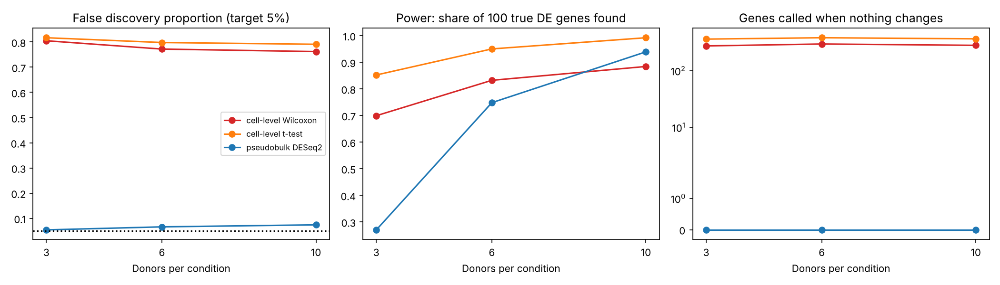
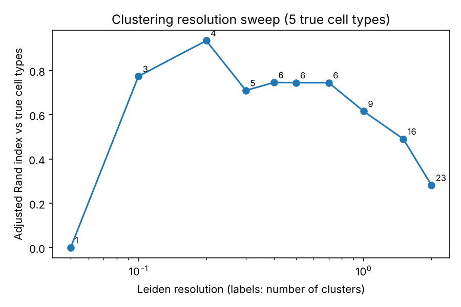

# Pseudobulk versus cell-level differential expression in single-cell RNA-seq

When a single-cell study compares conditions across people, the cells from one donor are not independent: they share that donor's genetics, environment, and sample handling. Testing each cell as if it were a replicate (pseudoreplication) treats thousands of cells as thousands of independent observations when the real sample size is the number of donors. This project measures how much that matters on simulated multi-donor data where the true answer is known, and compares it with pseudobulk analysis, which sums counts per donor and cell type and tests across donors. A second part sweeps clustering resolution against known cell types.

A companion analysis of real data, interferon-beta response in human PBMCs, is in [scrnaseq-pbmc-interferon](https://github.com/pkamand1/scrnaseq-pbmc-interferon).

## Simulation

Each simulated study has:
- 2,000 genes and five cell types with marker genes.
- 300 cells per donor, with varying library sizes and negative binomial counts.
- Donor-specific expression shifts (standard deviation 0.25 on the log scale), the ordinary biological difference between people.
- In T cells, 100 genes that truly change with condition (log2 fold change of ±1). In a second scenario, no gene changes at all.

Studies with 3, 6, and 10 donors per condition were each simulated 8 times.

## Results



| Donors per condition | Method | Genes called (100 true) | False discovery proportion | Power | Genes called when nothing changes |
| --- | --- | --- | --- | --- | --- |
| 3 | cell-level Wilcoxon | 360 | 80% | 70% | 274 |
| 3 | cell-level t-test | 467 | 82% | 85% | 361 |
| 3 | pseudobulk DESeq2 | 29 | 5.4% | 27% | 0 |
| 6 | cell-level Wilcoxon | 367 | 77% | 83% | 296 |
| 6 | cell-level t-test | 472 | 80% | 95% | 382 |
| 6 | pseudobulk DESeq2 | 80 | 6.6% | 75% | 0 |
| 10 | cell-level Wilcoxon | 372 | 76% | 88% | 280 |
| 10 | cell-level t-test | 476 | 79% | 99% | 365 |
| 10 | pseudobulk DESeq2 | 101 | 7.4% | 94% | 0 |

At a 5% false discovery rate, the cell-level tests (the Wilcoxon test is the default in Scanpy's `rank_genes_groups`) report hundreds of significant genes, and about four out of five are false. In the null scenario, where no gene changes at all, they still call roughly 270 to 380 genes. Every one of those is a person-to-person difference mistaken for a treatment effect. Adding donors does not fix this, because the problem is the unit of analysis, not the sample size.

Pseudobulk DESeq2 calls nothing in the null scenario and keeps the false discovery proportion close to the 5% target, slightly above it at 6 and 10 donors. Its power depends on the number of donors, not cells: 27% of the true changes with 3 donors per group, 75% with 6, and 94% with 10. That is the honest cost of a small study, and a useful number for planning one.

### Clustering resolution



| Leiden resolution | Clusters | Adjusted Rand index |
| --- | --- | --- |
| 0.05 | 1 | 0.00 |
| 0.1 | 3 | 0.77 |
| 0.2 | 4 | 0.94 |
| 0.3 | 5 | 0.71 |
| 0.5 | 6 | 0.75 |
| 1.0 | 9 | 0.62 |
| 2.0 | 23 | 0.28 |

With five true cell types, the best agreement came at four clusters, where the rarest type (6% of cells) merged with a neighbour. The resolution that produced exactly five clusters split a common type instead of finding the rare one. Matching the number of clusters to an expected number of cell types is not the same as recovering them, which is why annotation should rest on marker genes and why rare populations deserve a targeted look.

## Repository layout

```
src/benchmark.py          simulation, cell-level and pseudobulk tests, clustering sweep, figures
tests/test_results.py     checks on the benchmark's conclusions
results/tables/           per-run results, summary, clustering sweep
results/figures/          figures above
```

## How to run

```
pip install -r requirements.txt
python src/benchmark.py --reps 8
python -m pytest -q tests
```

The full benchmark takes about ten minutes.

## Author

Patricia K. Kamanda. Released under the MIT License.
